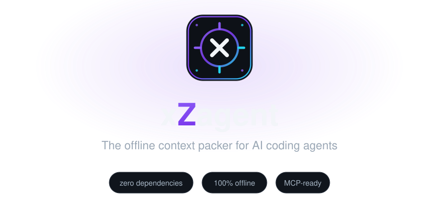
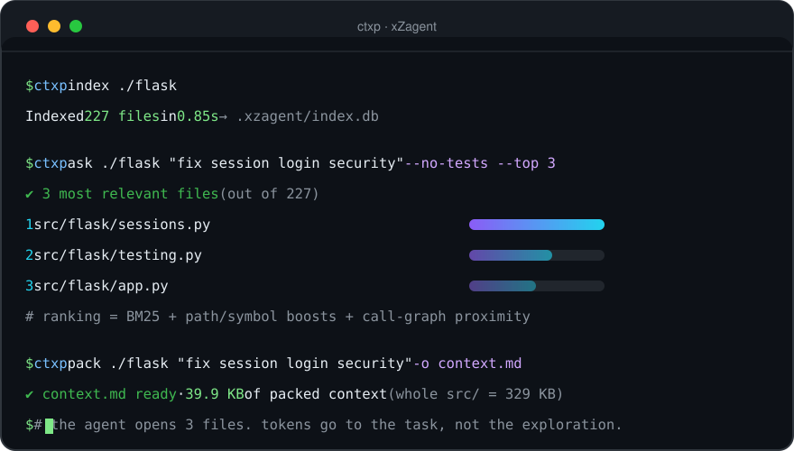
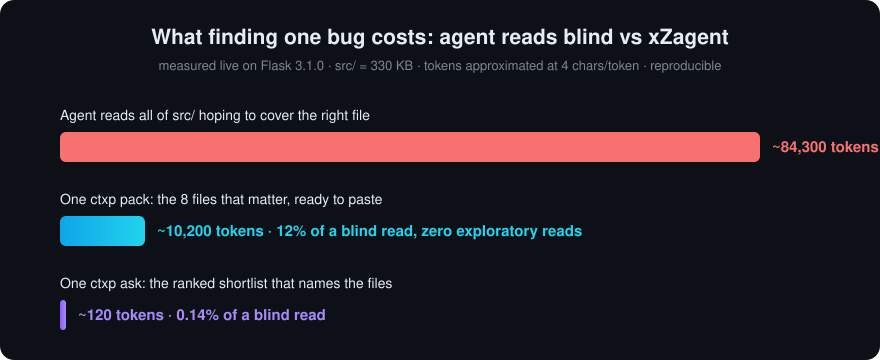
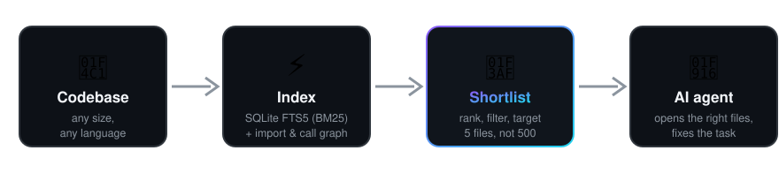

<div align="center">



**An AI agent dropped into a big codebase burns your tokens reading file after file, hoping to bump into the right one. xZagent gives it something better: a map of the whole project, and a ranked shortlist of the files that actually matter for the task at hand.**

[](https://www.python.org/)
[](#install)
[](#private-by-design)
[](#measured-not-estimated)
[](LICENSE)
[](https://github.com/shadow1t/xZagent/stargazers)

[Features](#features) · [Install](#install) · [Quickstart](#quickstart) · [MCP setup](#plug-it-into-your-ai-tools-mcp) · [How it works](#how-it-works) · [Full docs](docs/USAGE.md)



*Every number in that demo is real, produced by running `ctxp` against the Flask 3.1.0 repository (227 files).*

</div>

---

## Read this first: what a blind agent costs you

An AI agent dropped into a project it has never seen does the only thing it can: **read**. Line 1 to 100 of some file, nothing there, 101 to 200, still nothing, next file. Every exploratory chunk is billed twice: once when the agent reads it, and again every time it keeps sitting in the conversation. The three files that actually matter might be 250 files away, waiting to be "discovered".

This is not a feeling, it is arithmetic. Measured live against Flask 3.1.0 (~330 KB of `src/`, this exact run, reproducible):

| Finding `fix session login security` | Context burned |
|---|---|
| Agent reads all of `src/` to be sure nothing is missed | **~84,300 tokens** |
| `ctxp pack` -- the 8 files that matter, ready to paste | **~10,200 tokens** · 12% of a blind read |
| `ctxp ask` -- the ranked shortlist that names those files up front | **~120 tokens** · 0.14% of a blind read |

<div align="center"></div>

xZagent exists for the part that comes before the coding: it indexes your project offline once, then tells the agent **where to look** and **what to ignore**, in a fraction of a percent of the tokens a blind read costs.

## Why this exists

Open a 500-file project in any AI coding tool and ask for a small fix. The agent's first moves give it away: it opens a random file, skims it, gets lost, opens another. Every exploratory read costs tokens and context, while the files that actually matter are drowning in noise:

- test files that **name** what you want without **being** it
- docs that outrank code
- `api_v2` hiding in a sea of `api`, `api_v1`, `api_legacy`

xZagent fixes the part that comes before the coding. It indexes the project offline into a single SQLite file, then answers the questions an experienced developer answers in their head before touching code:

| Question | Command |
|---|---|
| What does this codebase look like? | `ctxp map` |
| Which files matter for *this exact task*? | `ctxp ask` |
| What is in this file, and who calls it? | `ctxp graph` |
| Give me a ready-made context pack | `ctxp pack` |

## Why agents get better results with it

| Without xZagent | With xZagent |
|---|---|
| Guesses where code lives | Ranked shortlist per task |
| Reads files one by one | Repo map + import/call graph upfront |
| Tests and docs hijack attention | `--no-tests`, `--only-ext`, `--only-dirs` filters |
| Whole folders get pasted into context | One ~40 KB context pack (measured on Flask: 40.8 KB vs 337 KB of `src/`) |
| Cloud indexing, API keys, creepy | 100% offline, SQLite next to your code |

## How it works

<p align="center"></p>

1. **Scan** the project (honors `.gitignore`, your `.xzagentignore`, and sensible defaults like `node_modules`, lockfiles, `*.min.js`, backups).
2. **Index** into SQLite: full-text with BM25 via FTS5, plus symbols extracted with Python's `ast` (exact) and battle-tested regex for JS/TS, Go, Rust, Java, C/C++, Ruby, PHP and more. Imports are resolved to real files, and call edges between symbols are recorded.
3. **Rank** for a task: BM25 relevance + path/symbol boosts + **graph proximity** (files that import or call your top hits get pulled up, so the shortlist is coherent, not just keyword soup).

The index lives at `.xzagent/index.db` and refreshes automatically when files change. No server, no daemon, no build step.

## Features

- 🔌 **Works with Claude Code, Cursor, Codex, Antigravity, Windsurf and any MCP client** via a stdio MCP server exposing 9 tools (`repo_map`, `find`, `find_files`, `recent_files`, `file_outline`, `call_graph`, `neighbors`, `context_pack`, `db_schema`)
- 🎯 **Smart targeting filters** so the agent works on `api_v2*` instead of every API file across versions, drops test-file hijackers with `--no-tests`, restricts ranking to real code with `--only-ext .py`, or to whole areas with `--only-dirs api,ui`. A pattern search also globs the disk directly, so even noise-skipped temp files (`tmp_*`) are found when you explicitly name them
- 🗺️ **A repo map that scales**: every directory is always shown, only files per directory are capped, so a 3,000-file repo still renders a readable structure (`--full` for everything)
- 🚀 **Fast**: indexed Flask's 227 files in **0.7 s** on a modest sandbox
- 🕵️ **Private by design**: no network calls, no API keys, no telemetry. Ever. Works on air-gapped machines and planes
- 🎨 **A real terminal experience**: violet→cyan gradient ranking bars in `ask`, a live progress bar (spinner + counts + percent + phase notes) during ANY index build -- explicit or the automatic rebuild behind `ask`/`map`/`find` -- with a guaranteed-animation ticker so the CLI never looks stuck. Auto-disabled when piped, respects `NO_COLOR`
- 🔄 **One-command self-update**: `ctxp update` pulls your clone and reinstalls in place -- no more `pip uninstall && pip install`, a live spinner through the install, concurrent updaters serialized behind a lock. On Windows it even beats the `ctxp.exe` file lock: the live exe is renamed aside (running exes can be renamed, not overwritten) so the whole update runs inside one normal command, result printed, prompt back when it truly finished; the old detour around the prompt stays only as a rare fallback
- 🧰 **Zero dependencies**: pure Python 3.9+ standard library. `pip install` and done
- 🐘 **DB-aware**: even skips `migrations/` while still feeding the `db_schema` tool with tables, columns and foreign keys

## Install

```bash
git clone https://github.com/shadow1t/xZagent.git
cd xZagent
pip install .          # gives you the `ctxp` command
```

Requires Python ≥ 3.9. Pure standard library: nothing else to download, ever.

Upgrading is one command (`git pull` + reinstall, no `pip uninstall` needed):

```bash
ctxp update            # from your clone, an enclosing checkout, or GitHub
```

Removing it is one command too (asks first; `--yes` skips the question):

```bash
ctxp uninstall          # removes the CLI; project data is never touched
ctxp uninstall --purge  # also removes ~/.xzagent (the global config dir)
```

`ctxp uninstall` never deletes project data: each project's `.xzagent/`
index is plain project files, and MCP client configs belong to their
projects (clean one with `ctxp setup --remove` inside it). Reinstall
any time with `pip install git+https://github.com/shadow1t/xZagent.git`.
While a command runs, Ctrl+C asks before it stops: `y` stops (exit 130),
Enter keeps going, and a second Ctrl+C stops right away.

## Quickstart

```bash
ctxp index ./my-project                  # build the index (auto-refreshes later)
ctxp map  ./my-project                   # structural map, every directory shown
ctxp ask  ./my-project "fix login bug"   # ranked shortlist for the task
ctxp pack ./my-project "add dark mode" -o context.md   # ready-to-paste context pack
```

Target the work precisely:

```bash
ctxp ask  ./my-project "billing" --only-ext .py --no-tests   # rank code, not docs, not tests
ctxp find ./my-project "api_v2*"                             # only the v2 API files
ctxp find ./my-project --only-dirs api,ui --recent --top 5   # freshest files in the areas you care about
ctxp graph ./my-project login                                # who calls login, what login calls
```

Every flag composes: `--pattern`, `--only-dirs`, `--only-ext`, `--no-tests`, `--skip-ext`, `--skip-dirs`, `--recent`, `--top`. Every command explains itself: `ctxp -h` for the overview, `ctxp help <command>` for one command in depth. Full reference in the [usage guide](docs/USAGE.md).

## Plug it into your AI tools (MCP)

One command, run inside your project, wires up the clients:

```bash
cd your-project
ctxp setup        # writes .mcp.json (Claude Code) + .cursor/mcp.json (Cursor)
```

The config lives INSIDE the project and is **portable by default**: `ctxp serve .`, no machine-specific paths, so it is safe to commit, and anyone with `ctxp` installed gets the tools working. Claude Code asks you to approve the project's tools once (`/mcp` to verify); Cursor needs one restart. An AI agent asked to "set up MCP" no longer burns your time fumbling with paths: `ctxp setup` is the whole job.

Whole-machine clients are one command too: `ctxp setup --client antigravity` (and `--client windsurf`) edits the app's GLOBAL config for you, with an absolute entry for this project and a per-project server key so several projects can coexist in one file. `ctxp setup --client generic` prints a ready-to-paste snippet for any other stdio client, and `ctxp setup --remove` takes the server back out cleanly. `ctxp setup --absolute` pins your machine's paths instead of the portable form, for clients that launch servers from an odd working directory; that flavor never goes in a commit.

<details><summary>Manual configs (user scope, multiple projects, any client)</summary>

The whole connection is one entry in the file the client already reads
(stdio JSON-RPC child process, no daemon, nothing keeps running after
the client exits). Claude Code:

```bash
claude mcp add xzagent -- ctxp serve /path/to/project
```

Codex (it keeps servers in TOML):

```bash
codex mcp add xzagent -- ctxp serve /absolute/path/to/project
```

Cursor / Windsurf / any JSON `mcpServers` client:

```json
{
  "mcpServers": {
    "xzagent": { "command": "ctxp", "args": ["serve", "/absolute/path/to/project"] }
  }
}
```

Antigravity: `ctxp setup --client antigravity` edits its global config
itself (absolute entry, per-project key, several projects coexist).
Exact per-client recipes: [docs/USAGE.md · MCP setup](docs/USAGE.md).
</details>

From that moment the agent asks for the map instead of wandering, greps your indexed shortlist instead of grepping the whole disk, and checks the call graph before refactoring.

## Measured, not estimated

Real numbers from this repository's tests and demos (Flask 3.1.0, 227 files, modest cloud sandbox):

| Operation | Result |
|---|---|
| Fresh index of the repo | **0.71 s** |
| `ask "fix session login security"` | top 3 hits are exactly the right modules (`sessions.py`, `testing.py`, `app.py`) |
| `pack` output for that task | **40.8 KB** of context vs **337 KB** of raw `src/` (8× smaller, and that's before ignoring docs and examples) |
| Test suite | **129 tests, ~7 s**, stdlib only |

## Private by design

xZagent makes no network calls, uses no API keys, and collects no telemetry. The entire index is **one SQLite file inside your project** (`.xzagent/index.db`). It runs on air-gapped machines, inside corporate VPNs, and at 36,000 feet. Your code never leaves your machine.

Permanently exclude anything from the index with a `.xzagentignore` file (gitignore syntax, with `!` negations to re-include defaults):

```gitignore
docs/
generated/
!migrations/        # index migrations after all, I actively edit them
```

## Project structure

```
src/xzagent/    scanner, symbols, index, rank, graph, map, find, packer, schema, MCP server
docs/USAGE.md   full CLI and MCP reference
AGENTS.md       guidance for AI agents hacking on xZagent itself
```

## Contributing

PRs are welcome. The project is deliberately stdlib-only: please keep new features dependency-free. Run the suite before opening a PR:

```bash
python -m unittest discover -s tests -v   # 129 tests
```

## License

[MIT](LICENSE) © 2026 [shadow1t](https://github.com/shadow1t)